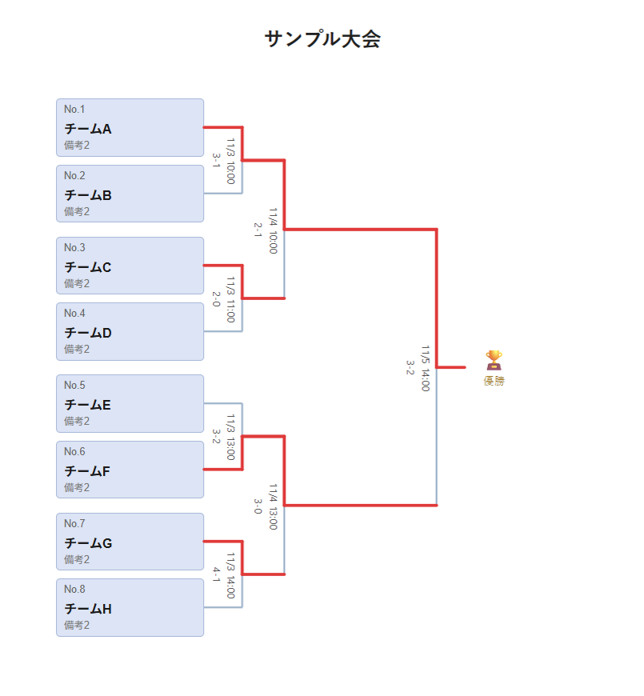
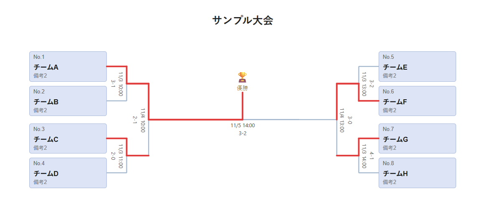
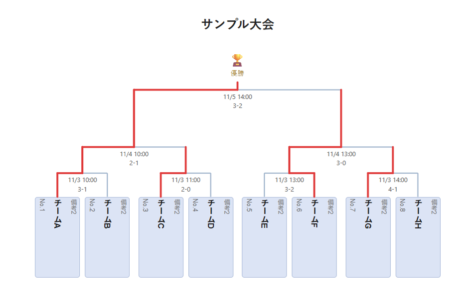
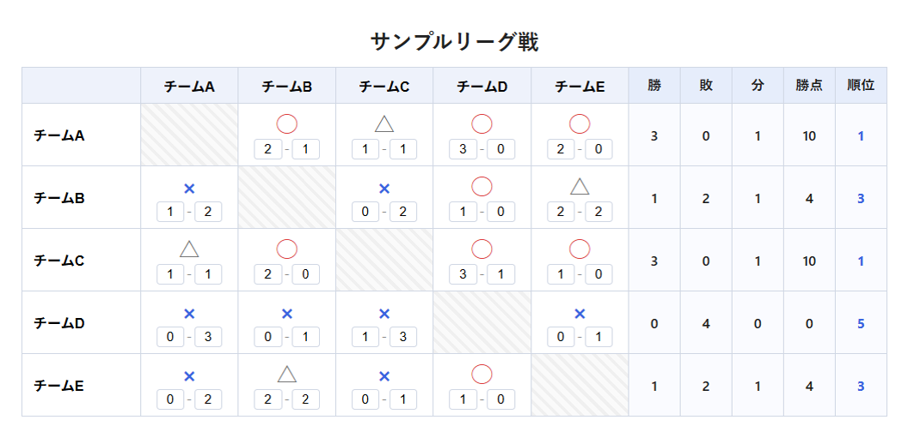
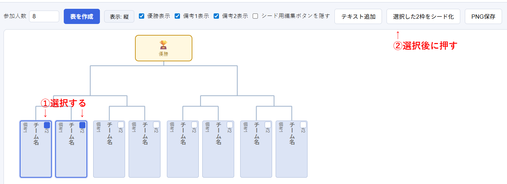
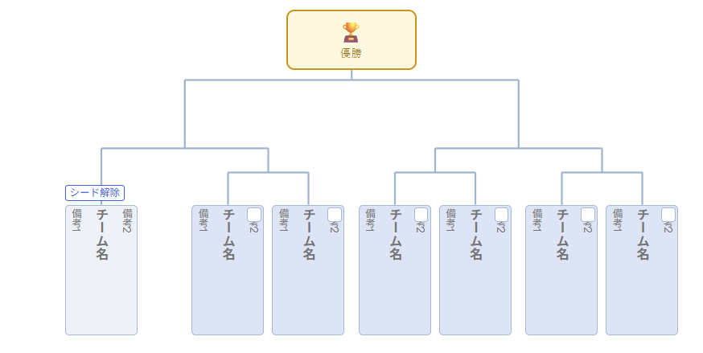

# BracketMaker

トーナメント表・リーグ戦表(総当たり表)を手軽に作成できる、印刷・PNG/PDF保存に特化したWindows向けデスクトップアプリです。

大会の組み合わせ表を手書きしたり、Excelでズレに悩まされたりする手間をなくすために作りました。参加チームを入力するだけで、きれいな罫線のトーナメント表・リーグ戦表を自動生成し、そのままPNG画像・PDFとして保存・印刷できます。

## 主な特徴

- **トーナメント表を3種類の形式で表示**:横通常・横左右型(左右対抗式)・縦
- **リーグ戦表(総当たり表)** にも対応
  - 表示を「スコアのみ」「スコア＋◯×」「◯×のみ」から選べます。◯×はマスをクリックするたびに切り替わります(◯→×→△→空)
  - **勝・敗・分・勝点・順位の自動集計**は、必要な人だけ使えるオプションです。オフのままなら表示されません。使うときも勝点のルール(初期は勝3・分1・敗0)を変えられます
  - 結果だけを消す「結果クリア」にも対応
- **シード・不戦勝(bye)** に対応
  - 参加人数が2の累乗(8・16・32…)でないときは、不戦勝が表全体にばらけて**自動で割り当て**られます
  - 手動の調整も簡単です。2枠を選んでシード化、「シード解除」で戻せます
- **各試合の日時・スコア**を、試合の線のすぐ横に入力できます(表示のON/OFFはそれぞれ別々に切り替え可能)
- **勝ち上がりの赤線**:各チームの枠の右下の「勝」ボタンを押すたびに、そのチームの赤線が1回戦ぶん先へ伸びます。左右型では、決勝進出者の線は準決勝で止まり、決勝の勝者だけが優勝まで赤線でつながります
- **タイトル欄**(大会名など)を表の上に入力。トーナメント表・リーグ戦表の両方で使えます
- 優勝ボックス、備考欄(備考1・備考2)、日時、スコアの**表示/非表示**切り替え
- チーム名の枠の**中の色**(白・薄グレーなど)と、**枠線のON/OFF**の切り替え
- 表の**拡大・縮小**(画面表示用。保存する画像・PDFは常に等倍です)
- 日時やメモを自由な位置に置ける**テキスト注釈**機能(ドラッグで移動、縦書き/横書き切り替え可)
- **PNG画像**または**PDF**でワンクリック保存
  - PDFは表の大きさに合わせて、**A4/A3の用紙と縦横の向きを自動で選び**、1ページに収めます
- **サンプル表示**で完成イメージを確認でき、**全クリア**でいつでもまっさらに戻せます
- 参加人数を後から変更しても、入力済みのチーム名が消えない
- 日本語 / English / 한국어 / 简体中文 / 繁體中文 / Español に対応

## スクリーンショット

下の画像は「サンプル表示」で出した例です。

### トーナメント表(横通常)

### トーナメント表(横左右型)

優勝を中央に置き、左右対抗形式で表示する形式です。

### トーナメント表(縦)

### リーグ戦表(総当たり表)

◯×とスコアを一緒に表示し、勝・敗・分・勝点・順位の集計もオンにした例です。

勝・敗・分・勝点・順位の集計は、表示設定の「集計表示」をオフにすれば表示されません。対戦結果を手書きしたい場合は、スコアや◯×も非表示にして、枠だけの表として使えます。

### シード・不戦勝の設定

人数が2の累乗でないときは不戦勝が自動で入りますが、手動でも調整できます。同じ対戦カード内の2枠を選択し、「選択した2枠をシード化」を押すだけでシード(不戦勝)を設定できます。

設定すると、対戦相手のいない枠は「シード解除」タグ付きの空欄になり、対戦線も1本のまっすぐな線になります。

## 使い方

1. 参加人数を入力して「表を作成」をクリック(人数が2の累乗でないときは、不戦勝が自動で割り当てられます)
2. 各枠にチーム名(と必要なら備考)を入力
3. 表示形式(横通常 / 横左右型 / 縦)を選択
4. 「表示設定」で、優勝・備考・日時・スコアの表示や、枠の色・枠線を整える。シードの手動調整やテキスト注釈も必要に応じて追加
5. 組み合わせが決まったら、そのまま「PNG保存」または「PDF保存」で保存して印刷・配布できます(日時・スコア・赤線は後から入れても構いません)
6. 試合が進んだら、日時・スコアを入力し、勝ち上がったチームの「勝」ボタンを押して赤線を伸ばし、もう一度保存します

リーグ戦表も同じ流れです。◯×はマスをクリックして入力し、集計が必要なときだけ「集計表示」をオンにします。

はじめて使うときは「サンプル表示」を押すと、完成イメージを確認できます。入力を一からやり直したいときは「全クリア」を押してください。

## ダウンロード

- [Releases](../../releases) から最新版をダウンロードできます
- Booth でも配布しています

## 対応環境

- Windows

## 作者

作者の他のツール: [daigorou-Tools](https://daigorou-addon.github.io/daigorou-tools/)

## サポート

このアプリが役に立ったら、[Buy Me a Coffee](https://buymeacoffee.com/daigorou) でご支援いただけると嬉しいです。

---

# BracketMaker

A Windows desktop app for easily creating tournament brackets and league tables (round-robin charts), designed for printing and saving as PNG or PDF.

I made this to save you from hand-drawing tournament brackets or fighting with misaligned cells in Excel. Just enter the participating teams, and the app automatically generates a cleanly ruled tournament bracket or league table that you can save as a PNG image or PDF, or print right away.

## Features

- **Three tournament bracket layouts**: Horizontal, Horizontal Split (two-sided), and Vertical
- **League tables (round-robin charts)** supported as well
  - Choose how results are shown: "Score only", "Score + ○×", or "○× only". Click a cell to cycle through ○ → × → △ → empty
  - **Automatic standings (W / L / D / points / rank)** are optional. If you leave them off, they aren't shown at all. When you use them, the point values (default: win 3, draw 1, loss 0) can be changed
  - "Clear Results" wipes only the results
- **Seeds and byes**
  - When the number of participants isn't a power of two (8, 16, 32…), byes are **assigned automatically**, spread across the whole bracket
  - Manual adjustment is easy too: select two slots to make a seed, or use "Remove seed" to undo it
- Enter a **date/time and score for each match** right beside its line (each can be shown or hidden separately)
- **Red advancement lines**: each click on the "W" button at the bottom right of a team's box extends that team's red line by one round. In the two-sided layout, the finalists' lines stop at the semifinal, and only the final's winner is connected all the way to the champion
- A **title field** (for the event name, etc.) above the bracket, for both tournament brackets and league tables
- Toggle the **champion box**, **note fields (Note 1 / Note 2)**, **date/time**, and **score** on or off
- Change the **fill color** of the team boxes (white, light gray, etc.) and turn the **border** on or off
- **Zoom in/out** the table (screen display only; saved images and PDFs are always at 100%)
- **Text annotations** that can be placed anywhere for dates or memos (drag to move, switch between vertical and horizontal text)
- **Save as PNG** or **PDF** in one click
  - For PDF, the app **picks A4 or A3 and the orientation automatically** to match the size of the table, and fits it on one page
- **Show Sample** to see what a finished table looks like, and **Clear All** to start from a blank slate anytime
- Changing the number of participants later won't erase the team names you've already entered
- Available in 日本語 / English / 한국어 / 简体中文 / 繁體中文 / Español

## Screenshots

The images below were produced with "Show Sample".

### Tournament Bracket (Horizontal)

### Tournament Bracket (Horizontal Split)

Places the champion in the center and displays the bracket in a two-sided format.

### Tournament Bracket (Vertical)

### League Table (Round-Robin Chart)

An example showing ○× together with scores, with the standings (W / L / D / points / rank) turned on.

The standings are hidden when you turn off "Show Standings" in View Settings. If you'd like to write in the results by hand, you can also hide the scores and ○× and use it as an empty grid.

### Setting Seeds and Byes

Byes are assigned automatically when the number of participants isn't a power of two, but you can also adjust them by hand. Select two slots within the same match and click "Make selected 2 slots a seed" to set up a seed (bye).

Once set, the slot without an opponent becomes an empty field with a "Remove seed" tag, and the match line becomes a single straight line.

## How to Use

1. Enter the number of participants and click "Create Bracket" (if the number isn't a power of two, byes are assigned automatically)
2. Enter team names (and notes, if needed) in each slot
3. Choose a layout (Horizontal / Horizontal Split / Vertical)
4. In "View Settings", adjust what is shown (champion, notes, date/time, score) and the box color and border. Add manual seed adjustments and text annotations as needed
5. As soon as the matchups are decided, you can save it right away with "Save PNG" or "Save PDF" to print or share (dates, scores, and red lines can be added later)
6. As the matches are played, enter dates and scores, press the "W" button of each team that advances to extend its red line, and save again

League tables work the same way. Click a cell to enter ○×, and turn on "Show Standings" only when you need the totals.

If you're trying it for the first time, press "Show Sample" to see a finished example. To start over from scratch, press "Clear All".

## Download

- Download the latest version from [Releases](../../releases)
- Also available on Booth

## Requirements

- Windows

## Author

Other tools by the author: [daigorou-Tools](https://daigorou-addon.github.io/daigorou-tools/)

## Support

If you find this app useful, I'd appreciate your support via [Buy Me a Coffee](https://buymeacoffee.com/daigorou).
